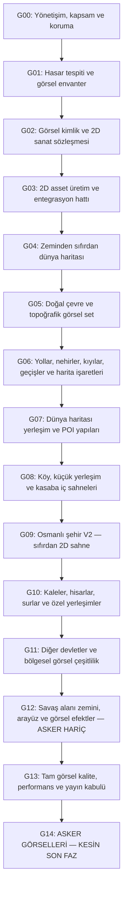

# FOC WEB — GÖRSEL İLERLEME AĞACI

**Kapsam:** 15 faz, 215 görev/kapı.
**Durum:** Bunların hiçbiri henüz tamamlandı sayılmaz; tümü plan veya bloke.

## Faz bağımlılık omurgası

**Not:** Bu omurga bilinçli olarak kontrollü sırayı gösterir. Her faz içindeki bağımsız görevler paralel yapılabilir, fakat bir sonraki fazın kapsamlı sanat üretimi önceki kabul kapısı geçmeden başlamaz.

## G00 — Yönetişim, kapsam ve koruma
> Amaç: Tüm görsel değişiklikleri gameplay ve Unity’den ayırmak
> Çıkış kapısı: **Dökümantasyon ve geri dönüş sözleşmesi onaylı; oyun koduna dokunulmaz**

- [ ] **G00-01 — Web-only proje sınırını kesinleştir**  
  - Çıktı: Yalnız FallOfCavalry web depo bağlantısı ve dışlanan Unity kaynak listesi  
  - Kabul: Her PR sadece web deposu yoluna dokunur; Unity bağı yoktur  
  - Sorumlu: `TEKNIK` · Ön koşul: `—` · Durum: `PLANLANDI`
- [ ] **G00-02 — Sıfırdan 2D üretim kararını kaydet**  
  - Çıktı: 2D doğrudan çizim; 3D/3D render yok; asker son faz  
  - Kabul: Karar defterinde aynı kural tek kaynak olarak mevcut  
  - Sorumlu: `ORTAK` · Ön koşul: `—` · Durum: `PLANLANDI`
- [ ] **G00-03 — Önceki 72 iş paketinin sanat dondurma kararına ek karar yaz**  
  - Çıktı: Görsel işlerin yeniden açıldığı; asker görsellerinin son aşamaya ertelendiği değişiklik kaydı  
  - Kabul: Önceki plan silinmez, yeni tarihli kararla çelişki açıkça çözülür  
  - Sorumlu: `TEKNIK` · Ön koşul: `—` · Durum: `PLANLANDI`
- [ ] **G00-04 — Grafik ile oyun mekaniği sınırını belirle**  
  - Çıktı: Değişmeyecek sahiplik, movement, ekonomi, save, şehir area ID listesi  
  - Kabul: Görsel PR sonrası gameplay state eşitliği testi tanımlı  
  - Sorumlu: `TEKNIK` · Ön koşul: `—` · Durum: `PLANLANDI`
- [ ] **G00-05 — Legacy asset geri dönüş planını yaz**  
  - Çıktı: Eski görsel modun feature flag ile korunacağı rollback protokolü  
  - Kabul: Yeni render çökerse aynı save ile eski görünüm açılabilir  
  - Sorumlu: `TEKNIK` · Ön koşul: `—` · Durum: `PLANLANDI`
- [ ] **G00-06 — Asset hak ve kaynak kökeni kuralını koy**  
  - Çıktı: Her 2D asset için üretici, araç, haklar, kaynak sürüm bilgisi  
  - Kabul: Kökeni bilinmeyen asset nihai dağıtıma giremez  
  - Sorumlu: `ORTAK` · Ön koşul: `—` · Durum: `PLANLANDI`
- [ ] **G00-07 — Asker görsel değişikliklerini yasak bölgeye al**  
  - Çıktı: Soldier visual code ve atlaslar için dokunma listesi  
  - Kabul: Son fazdan önce askere ait yeni PNG, atlas veya animasyon PR yok  
  - Sorumlu: `TEKNIK` · Ön koşul: `—` · Durum: `PLANLANDI`
- [ ] **G00-08 — İş durum sözlüğünü ve kanıt hiyerarşisini kur**  
  - Çıktı: PLANLANDI/URETIMDE/ENTEGRASYONDA/TESTTE/KABUL/BLOKLU ve kanıt türleri  
  - Kabul: Test, ekran görüntüsü ve PR adresi olmadan KABUL verilemez  
  - Sorumlu: `TEKNIK` · Ön koşul: `—` · Durum: `PLANLANDI`
- [ ] **G00-09 — İlk tasarım kapısını kullanıcıya sun**  
  - Çıktı: Temel estetik, üretecek kişi, sıranın ve rollerin onayı  
  - Kabul: Yetki dışı stil ve kapsam değişikliği yapılmaz  
  - Sorumlu: `KARAR` · Ön koşul: `—` · Durum: `PLANLANDI`
- [ ] **G00-GATE — Yönetişim, kapsam ve koruma kalite ve kullanıcı geçiş kapısı**  
  - Çıktı: G00 teslim özeti, test raporu, görsel kabul, açık risk ve rollback notu  
  - Kabul: Dökümantasyon ve geri dönüş sözleşmesi onaylı; oyun koduna dokunulmaz  
  - Sorumlu: `KARAR` · Ön koşul: `G00-01, G00-02, G00-03, G00-04, G00-05, G00-06, G00-07, G00-08, G00-09` · Durum: `PLANLANDI`

## G01 — Hasar tespiti ve görsel envanter
> Amaç: Aktif kod yollarını ve tüm görsel borçları gerçek kanıtla belirlemek
> Çıkış kapısı: **V01 görsel hasar defteri ve tekrar üretilebilir ekran baz çizgisi var**

- [ ] **G01-01 — HEAD, branch ve ZIP sürümlerini eşleştir**  
  - Çıktı: Main SHA, ZIP kaynak tarih/başlık farkları  
  - Kabul: Karşılaştırma yanlışlıkla Unity branch’ini kapsamaz  
  - Sorumlu: `TEKNIK` · Ön koşul: `G00-GATE` · Durum: `PLANLANDI`
- [ ] **G01-02 — Mevcut tüm görsel assetleri indeksle**  
  - Çıktı: Dosya yolu, tip, çözünürlük, alpha, kullanım yeri, köken envanteri  
  - Kabul: Her mevcut kaynak USED/LEGACY/PLACEHOLDER/UNKNOWN olarak etiketli  
  - Sorumlu: `TEKNIK` · Ön koşul: `G00-GATE` · Durum: `PLANLANDI`
- [ ] **G01-03 — Gerçek runtime çizim çağrı zincirini haritala**  
  - Çıktı: RenderManager, dimetric modules, city UI ve battle background çağrı diyagramı  
  - Kabul: Pasif map-renderer dosyasına yapılacak iş yazılmaz  
  - Sorumlu: `TEKNIK` · Ön koşul: `G00-GATE` · Durum: `PLANLANDI`
- [ ] **G01-04 — Sahne galerisi çıkar**  
  - Çıktı: Aynı seed için dünya 0.5/1/2 zoom, şehir, köy, kale, savaş zemin ekranları  
  - Kabul: Her sahne kaynak commit/seed/viewport ile eşleştirilmiş  
  - Sorumlu: `TEKNIK` · Ön koşul: `G00-GATE` · Durum: `PLANLANDI`
- [ ] **G01-05 — Zeminin mevcut darboğazlarını ölç**  
  - Çıktı: Doku tekrar izi, boş bölgeler, ölçek sorunu, sınır kesmeleri analizi  
  - Kabul: Kanıtlı hata ve estetik tercih ayrı etiketli  
  - Sorumlu: `ORTAK` · Ön koşul: `G00-GATE` · Durum: `PLANLANDI`
- [ ] **G01-06 — Biyom ve tek-çim ayarını belgeye geçir**  
  - Çıktı: WORLD_MAP_FORCE_SINGLE_GRASS_BIOME ve yerleşim üzerindeki etkiler  
  - Kabul: Biom çeşitliliği kararı açık; gameplay biome ile görsel biome karıştırılmaz  
  - Sorumlu: `TEKNIK` · Ön koşul: `G00-GATE` · Durum: `PLANLANDI`
- [ ] **G01-07 — Şehir base/overlay boşluklarını doğrula**  
  - Çıktı: baseImage:null, template manifest, area hotspots haritası  
  - Kabul: Hangi görsel bağlantıların boş olduğu somut dosya ve satırla gösterilir  
  - Sorumlu: `TEKNIK` · Ön koşul: `G00-GATE` · Durum: `PLANLANDI`
- [ ] **G01-08 — Köy ve kalelerin mevcut render yöntemini ayır**  
  - Çıktı: Map icon / settlement sprite / city interior ayrımı  
  - Kabul: Dünya haritasındaki ikon ile şehir içi sahne aynı asset sanılmaz  
  - Sorumlu: `TEKNIK` · Ön koşul: `G00-GATE` · Durum: `PLANLANDI`
- [ ] **G01-09 — Dünya haritası ve şehir ekranı perspektiflerini analiz et**  
  - Çıktı: Projeksiyon, normalize yüzde alanları, UI ölçekleme teknik notu  
  - Kabul: 64×32 world tile ile % city hotspot arasında bilinçsiz dönüşüm yapılmaz  
  - Sorumlu: `TEKNIK` · Ön koşul: `G00-GATE` · Durum: `PLANLANDI`
- [ ] **G01-10 — Sahne/atlas yükleme yolundaki fallback durumunu ölç**  
  - Çıktı: SpriteLoader varsayılan boş manifest ve ilgili uyarılar  
  - Kabul: Görsel teslimi sadece klasöre atınca görünür sanılmaz  
  - Sorumlu: `TEKNIK` · Ön koşul: `G00-GATE` · Durum: `PLANLANDI`
- [ ] **G01-11 — Bellek ve zoom performans başlangıcını ölç**  
  - Çıktı: FPS frame p95, JS heap, canvas cache, decode süresi, soğuk yükleme  
  - Kabul: Rakamlar gerçek cihazda ölçülüp cihaz bilgisiyle kaydedilir  
  - Sorumlu: `TEKNIK` · Ön koşul: `G00-GATE` · Durum: `PLANLANDI`
- [ ] **G01-12 — Telif ve lisans riski taraması yap**  
  - Çıktı: Mevcut assetler ve özellikle üçüncü taraf sanat köken listesi  
  - Kabul: Nihai pakete girecek her asset için yeniden üretim/izin kararı verilir  
  - Sorumlu: `ORTAK` · Ön koşul: `G00-GATE` · Durum: `PLANLANDI`
- [ ] **G01-13 — Hasar önceliklendirme toplantısı ve sıfır nokta onayı**  
  - Çıktı: BUG/INTEGRASYON/ART_GAP/OPTIMIZASYON ayrı iş listeleri  
  - Kabul: Kullanıcı baz çizgi raporunu onaylar; stil üretimi sonraki fazda açılır  
  - Sorumlu: `KARAR` · Ön koşul: `G00-GATE` · Durum: `PLANLANDI`
- [ ] **G01-GATE — Hasar tespiti ve görsel envanter kalite ve kullanıcı geçiş kapısı**  
  - Çıktı: G01 teslim özeti, test raporu, görsel kabul, açık risk ve rollback notu  
  - Kabul: V01 görsel hasar defteri ve tekrar üretilebilir ekran baz çizgisi var  
  - Sorumlu: `KARAR` · Ön koşul: `G01-01, G01-02, G01-03, G01-04, G01-05, G01-06, G01-07, G01-08, G01-09, G01-10, G01-11, G01-12, G01-13` · Durum: `PLANLANDI`

## G02 — Görsel kimlik ve 2D sanat sözleşmesi
> Amaç: Resim başlamadan tüm ekranların ortak sanat dilini sabitlemek
> Çıkış kapısı: **Dört pilot referans ve görsel kontrol kartı kabul edildi**

- [ ] **G02-01 — Tarihsel dönemin görsel tonunu belirle**  
  - Çıktı: Erken modern Osmanlı/Avrupa için renk ve atmosfer ilkeleri  
  - Kabul: Gerçekçilik düzeyi, okunabilirlik, HoMM3 esintisi açık yazılı  
  - Sorumlu: `ORTAK` · Ön koşul: `G01-GATE` · Durum: `PLANLANDI`
- [ ] **G02-02 — Dünya haritası perspektif şablonunu kur**  
  - Çıktı: 64×32 projeksiyonda kare, ev, ağaç ve duvar hizalama rehberi  
  - Kabul: Üst üste bindirilen 2D nesnelerin ayak noktası grid ile çakışır  
  - Sorumlu: `TEKNIK` · Ön koşul: `G01-GATE` · Durum: `PLANLANDI`
- [ ] **G02-03 — Şehir ve köy ekranı perspektif rehberini ayrı tanımla**  
  - Çıktı: Ikariam-benzeri alan sahnesi için onaylı bakış, derinlik ve ufuk kuralları  
  - Kabul: Dünya haritasının 64×32 geometrisi şehre körü körüne uygulanmaz  
  - Sorumlu: `ORTAK` · Ön koşul: `G01-GATE` · Durum: `PLANLANDI`
- [ ] **G02-04 — Savaş zemini 2D kamera/görsel ayrı standardını tanımla**  
  - Çıktı: Savaş alanı zemin oranı, görüş mesafesi ve okunabilirlik sözleşmesi  
  - Kabul: Asker çizimleri değişmeden placeholder askerler okunur  
  - Sorumlu: `TEKNIK` · Ön koşul: `G01-GATE` · Durum: `PLANLANDI`
- [ ] **G02-05 — Tek ışık ve gölge karakterini kilitle**  
  - Çıktı: Ana ışık yönü, sertlik, yüzey gölgesi, ortak ambient kararları  
  - Kabul: Farklı üretimlerde ışık yönleri çelişmez  
  - Sorumlu: `ORTAK` · Ön koşul: `G01-GATE` · Durum: `PLANLANDI`
- [ ] **G02-06 — Ana renk paleti ve malzeme tablolarını belirle**  
  - Çıktı: Taş, ahşap, sıva, çatı, toprak, yeşillik, su için palet  
  - Kabul: Komşu assetler ton ve saturation bakımından bütün görünür  
  - Sorumlu: `ORTAK` · Ön koşul: `G01-GATE` · Durum: `PLANLANDI`
- [ ] **G02-07 — Harita zemini için örnek görsel kartı hazırlat**  
  - Çıktı: Sade düzlük, yol yakını, orman kenarı, kıyı pilot kompozisyonu  
  - Kabul: Aynı sanat dili dört durumda da okunur; ayrı üretime değer  
  - Sorumlu: `GORSEL` · Ön koşul: `G01-GATE` · Durum: `PLANLANDI`
- [ ] **G02-08 — Doğal çevre için siluet ve derinlik kartı hazırlat**  
  - Çıktı: 3 ağaç, 2 kaya, 2 çalı; ölçek ve renk kıyas kartı  
  - Kabul: Çim üstünde gövde zemine oturur; renk sapması yoktur  
  - Sorumlu: `GORSEL` · Ön koşul: `G01-GATE` · Durum: `PLANLANDI`
- [ ] **G02-09 — Yapı mimarisi referans kartları oluştur**  
  - Çıktı: Osmanlı ev/han/pazar/kale örnekleri, malzeme ve çağ özellikleri  
  - Kabul: Birbirini tutan çatılar, pencere oranı ve kule formu  
  - Sorumlu: `GORSEL` · Ön koşul: `G01-GATE` · Durum: `PLANLANDI`
- [ ] **G02-10 — Dört zoom/ekran okunabilirlik ölçütünü yaz**  
  - Çıktı: Ana ekran 0.5/1/2/5 zoom senaryoları ve UI örtüşme kuralları  
  - Kabul: Testte nesne sınıfı minimum görünür boyda ayırt edilebilir  
  - Sorumlu: `TEKNIK` · Ön koşul: `G01-GATE` · Durum: `PLANLANDI`
- [ ] **G02-11 — Büyük ölçekte doku tekrarı ve görsel karmaşa yasağı**  
  - Çıktı: Frekans/kontrast/karmaşa ve repeat seam kontrol listesi  
  - Kabul: Aynı PNG 20 kez tekrarlandığında fark edilir döşeme izi yok  
  - Sorumlu: `ORTAK` · Ön koşul: `G01-GATE` · Durum: `PLANLANDI`
- [ ] **G02-12 — Stil kilidi ve örnek kabul toplantısı**  
  - Çıktı: Onaylı style-card ID ve revizyon protokolü  
  - Kabul: Kullanıcı onayı olmadan stil sistemsel olarak değiştirilmez  
  - Sorumlu: `KARAR` · Ön koşul: `G01-GATE` · Durum: `PLANLANDI`
- [ ] **G02-GATE — Görsel kimlik ve 2D sanat sözleşmesi kalite ve kullanıcı geçiş kapısı**  
  - Çıktı: G02 teslim özeti, test raporu, görsel kabul, açık risk ve rollback notu  
  - Kabul: Dört pilot referans ve görsel kontrol kartı kabul edildi  
  - Sorumlu: `KARAR` · Ön koşul: `G02-01, G02-02, G02-03, G02-04, G02-05, G02-06, G02-07, G02-08, G02-09, G02-10, G02-11, G02-12` · Durum: `PLANLANDI`

## G03 — 2D asset üretim ve entegrasyon hattı
> Amaç: Görsel dosyası gelince standartlı olarak oyunda görünsün
> Çıkış kapısı: **PNG→katalog→konum→görünüm→test otomatik zinciri çalışıyor**

- [ ] **G03-01 — 2D asset adlandırma ve klasör kuralını kur**  
  - Çıktı: world/terrain,nature,roads,settlements; cities; ui; vfx dizinleri  
  - Kabul: Asset ID ve dosya yolu tekrarsız, küçük harfli, versiyonlu  
  - Sorumlu: `TEKNIK` · Ön koşul: `G02-GATE` · Durum: `PLANLANDI`
- [ ] **G03-02 — Ham dosya ile yayın varlığını ayır**  
  - Çıktı: sources/original; prepared; runtime klasörleri ve kaynak bağlantısı  
  - Kabul: Ham çizim asla doğrudan runtime ile karıştırılmaz  
  - Sorumlu: `TEKNIK` · Ön koşul: `G02-GATE` · Durum: `PLANLANDI`
- [ ] **G03-03 — Tek metadata sözleşmesi tasarla**  
  - Çıktı: id, scope, faction, dimensions, pivot, anchor, layer, rights, hashes  
  - Kabul: Eksik zorunlu alan build veya validator tarafından rapor edilir  
  - Sorumlu: `TEKNIK` · Ön koşul: `G02-GATE` · Durum: `PLANLANDI`
- [ ] **G03-04 — PNG şeffaflık ve kırpma doğrulayıcısı**  
  - Çıktı: RGBA/alpha, taşma, halo ve crop denetimi  
  - Kabul: Şeffaf PNG beyaz/karanlık saçak üretmeden zeminde yerleşir  
  - Sorumlu: `TEKNIK` · Ön koşul: `G02-GATE` · Durum: `PLANLANDI`
- [ ] **G03-05 — Pivot/footprint/hitbox/selection ayrımını kodla**  
  - Çıktı: Dünya taban noktası, çizim offset, tıklama alanı ayrı veri  
  - Kabul: Görsel değişimi fiziksel seçim veya konumu bozmaz  
  - Sorumlu: `TEKNIK` · Ön koşul: `G02-GATE` · Durum: `PLANLANDI`
- [ ] **G03-06 — Dünya ve şehir için ayrı 2D loader köprüleri tasarla**  
  - Çıktı: SpriteLoader registry ve city manifest resolver sözleşmesi  
  - Kabul: Bir asset hem manifestte hem runtime rendererda çözümlenir  
  - Sorumlu: `TEKNIK` · Ön koşul: `G02-GATE` · Durum: `PLANLANDI`
- [ ] **G03-07 — Şehir manifest şemasını varsayımsız şekillendir**  
  - Çıktı: base, overlays, parcels, relative transform, visibility, fallback alanları  
  - Kabul: Mevcut city-scene-defs ID’leri aynen korunur  
  - Sorumlu: `TEKNIK` · Ön koşul: `G02-GATE, G03-06` · Durum: `PLANLANDI`
- [ ] **G03-08 — 2D renderer için feature-flag ve rollback entegrasyonu**  
  - Çıktı: legacy/new toggle; test durumunda fallback  
  - Kabul: Yeni asset bozuksa önceki ekran ve save korunur  
  - Sorumlu: `TEKNIK` · Ön koşul: `G02-GATE, G03-06` · Durum: `PLANLANDI`
- [ ] **G03-09 — Asset yükleme hatalarını gözlemlenebilir kıl**  
  - Çıktı: 404, wrong dimensions, missing alpha, duplicate ID logs  
  - Kabul: Hatalar oyun çökmeden manifest ID ile raporlanır  
  - Sorumlu: `TEKNIK` · Ön koşul: `G02-GATE` · Durum: `PLANLANDI`
- [ ] **G03-10 — Ölçek dönüşümü ve responsive yerleşim yardımcıları**  
  - Çıktı: world 64x32 ve city normalized stage dönüşüm yardımcıları  
  - Kabul: En az üç viewportta pivot ve hotspot kaymaz  
  - Sorumlu: `TEKNIK` · Ön koşul: `G02-GATE` · Durum: `PLANLANDI`
- [ ] **G03-11 — Çizim katmanlarının sıralama sözleşmesi**  
  - Çıktı: terrain→decal→path→shadow→structure→canopy→label→UI z-order  
  - Kabul: Ağaç ve bina çakışmasında arka/ön sıra doğru  
  - Sorumlu: `TEKNIK` · Ön koşul: `G02-GATE` · Durum: `PLANLANDI`
- [ ] **G03-12 — Atlas paketleme ve image decode planı**  
  - Çıktı: Küçük 2D varlık için atlas ve lazy-load planı  
  - Kabul: Boş atlas/404/bozuk atlas oyunu durdurmaz  
  - Sorumlu: `TEKNIK` · Ön koşul: `G02-GATE` · Durum: `PLANLANDI`
- [ ] **G03-13 — Otomatik asset teslim komutu tasarla**  
  - Çıktı: Validate, prepare, manifest, inspect, snapshot aşamaları  
  - Kabul: Bir komut manifest ve hataları üretir; production asset atlamaz  
  - Sorumlu: `TEKNIK` · Ön koşul: `G02-GATE, G03-03, G03-04, G03-07` · Durum: `PLANLANDI`
- [ ] **G03-14 — Golden screenshot ve görsel fark testlerini kur**  
  - Çıktı: Seedli screenshot, tolerans, mask, fark raporu  
  - Kabul: Gerçek sanat değişimi onaylanmadan golden güncellenmez  
  - Sorumlu: `TEKNIK` · Ön koşul: `G02-GATE` · Durum: `PLANLANDI`
- [ ] **G03-15 — Tam 2D pipeline için dummy asset pilotu**  
  - Çıktı: Geçici kare/ağaç/ev PNG ile loader ve z-order uçtan uca  
  - Kabul: Dummy değişimiyle save/oyun verisi değişmez  
  - Sorumlu: `TEKNIK` · Ön koşul: `G02-GATE, G03-08, G03-13, G03-14` · Durum: `PLANLANDI`
- [ ] **G03-16 — Kullanıcı üretim teslim protokolünü onayla**  
  - Çıktı: PNG + referans + asset ID + haklar + revizyon sürümü listesi  
  - Kabul: Teslim için her defasında ne gerekli kullanıcı tarafından biliniyor  
  - Sorumlu: `KARAR` · Ön koşul: `G02-GATE` · Durum: `PLANLANDI`
- [ ] **G03-GATE — 2D asset üretim ve entegrasyon hattı kalite ve kullanıcı geçiş kapısı**  
  - Çıktı: G03 teslim özeti, test raporu, görsel kabul, açık risk ve rollback notu  
  - Kabul: PNG→katalog→konum→görünüm→test otomatik zinciri çalışıyor  
  - Sorumlu: `KARAR` · Ön koşul: `G03-01, G03-02, G03-03, G03-04, G03-05, G03-06, G03-07, G03-08, G03-09, G03-10, G03-11, G03-12, G03-13, G03-14, G03-15, G03-16` · Durum: `PLANLANDI`

## G04 — Zeminden sıfırdan dünya haritası
> Amaç: Eski grass görsellerini değiştirecek kurallı 2D zemin
> Çıkış kapısı: **Yeni arazi maskeleri ve döşeme sistemi ile boşluğa düşmeyen harita**

- [ ] **G04-01 — Dünya 1648 owner/terrain verisini görselden ayır**  
  - Çıktı: owner.bin, terrain.bin ve kaynak hashleri kilitle  
  - Kabul: Yeni sanat çalışması politik sınır/movement değerini değiştirmez  
  - Sorumlu: `TEKNIK` · Ön koşul: `G03-GATE` · Durum: `PLANLANDI`
- [ ] **G04-02 — Tek çim görsel zorlamasını karar paketine al**  
  - Çıktı: Mevcut forced-grass ayarı, görsel çokluk alternatifleri  
  - Kabul: Biyom oyuna geri konulacak mı kararı varsayımla verilmez  
  - Sorumlu: `KARAR` · Ön koşul: `G03-GATE` · Durum: `PLANLANDI`
- [ ] **G04-03 — Zemin ölçü/pixel yoğunluğu pilotunu seç**  
  - Çıktı: 64x32 screen tile için 2D kaynak çözünürlük ve LOD önerisi  
  - Kabul: Zoom 0.5/1/2/5’te kabul edilebilir tekrarsız görünüm  
  - Sorumlu: `ORTAK` · Ön koşul: `G03-GATE` · Durum: `PLANLANDI`
- [ ] **G04-04 — Yeniden üretilebilir temel çim seti**  
  - Çıktı: Ana yeşil zemin, gölge, micro-detail 2D varyantları  
  - Kabul: 16×16 tekrar deseninde seam ve görünür tekrar sınırı test edilir  
  - Sorumlu: `GORSEL` · Ön koşul: `G03-GATE` · Durum: `PLANLANDI`
- [ ] **G04-05 — Çim yakın/uzak varyantlarını çıkar**  
  - Çıktı: Farklı detay yoğunlukları ve tonları  
  - Kabul: Uzak zoomda noise/karmasa kontrol altında kalır  
  - Sorumlu: `GORSEL` · Ön koşul: `G03-GATE` · Durum: `PLANLANDI`
- [ ] **G04-06 — Toprak ve işlenmiş arazi çizim aileleri**  
  - Çıktı: Toprak, yol yakını, tarla/ekin dokuları  
  - Kabul: Çim-toprak geçişi sert kare sınırı yaratmaz  
  - Sorumlu: `GORSEL` · Ön koşul: `G03-GATE` · Durum: `PLANLANDI`
- [ ] **G04-07 — Taşlık ve sert yüzey aileleri**  
  - Çıktı: Taş, kayalık etek, kuru zemin görselleri  
  - Kabul: Objelerin ayak gölgesi zemine doğru oturur  
  - Sorumlu: `GORSEL` · Ön koşul: `G03-GATE` · Durum: `PLANLANDI`
- [ ] **G04-08 — Kıyı ve su taban görselleri**  
  - Çıktı: Kıyı, nehir yatağı ve su içi stil seti  
  - Kabul: Toprak-su maskesi kopuk/ani köşe yaratmaz  
  - Sorumlu: `GORSEL` · Ön koşul: `G03-GATE` · Durum: `PLANLANDI`
- [ ] **G04-09 — Terrain transition mask atlası**  
  - Çıktı: Kenar, köşe, iç köşe, birleşme ve fallback maskeleri  
  - Kabul: En az 16 komşuluk kombinasyonunda boşluk yok  
  - Sorumlu: `TEKNIK` · Ön koşul: `G03-GATE, G04-04, G04-06, G04-08` · Durum: `PLANLANDI`
- [ ] **G04-10 — Farklı zeminleri procedural yerleştirme**  
  - Çıktı: Seedli geometri-üstü visual variation; gameplay’den ayrı  
  - Kabul: Aynı seed aynı sanat yerleşimini verir; save boyutu artmaz  
  - Sorumlu: `TEKNIK` · Ön koşul: `G03-GATE` · Durum: `PLANLANDI`
- [ ] **G04-11 — Tiling seam ve doku tekrar kontrolü**  
  - Çıktı: Döşeme görsel karşılaştırma gridleri  
  - Kabul: 20×20 zeminde açık dikiş çizgisi gözükmez  
  - Sorumlu: `TEKNIK` · Ön koşul: `G03-GATE` · Durum: `PLANLANDI`
- [ ] **G04-12 — Dimetrik terrain cache entegrasyonu**  
  - Çıktı: Chunk cache, biome-base fallback, memory budget entegrasyonu  
  - Kabul: Doku gelmediğinde siyah boşluk/kaybolma yok  
  - Sorumlu: `TEKNIK` · Ön koşul: `G03-GATE, G04-09, G04-10` · Durum: `PLANLANDI`
- [ ] **G04-13 — Yerleşim ve UI altında zemin okunabilirliği**  
  - Çıktı: Yerleşim çevresi sakinleştirme/kontrast maskesi  
  - Kabul: Şehir ikonlarının silueti arka plan tarafından yutulmaz  
  - Sorumlu: `TEKNIK` · Ön koşul: `G03-GATE` · Durum: `PLANLANDI`
- [ ] **G04-14 — Zemin snapshot acceptance paketi**  
  - Çıktı: Harita 4 zoom × 3 bölge × 2 kamera hareketi  
  - Kabul: Ekranlar karşılaştırmalı kanıtla kabul edilir  
  - Sorumlu: `TEKNIK` · Ön koşul: `G03-GATE` · Durum: `PLANLANDI`
- [ ] **G04-15 — Savaş zeminine istenmeden yansıma regresyonu**  
  - Çıktı: main-ground-texture ortak referanslarının denetimi  
  - Kabul: Savaş alanı değişikliği özel onay olmadan etkilenmez  
  - Sorumlu: `TEKNIK` · Ön koşul: `G03-GATE` · Durum: `PLANLANDI`
- [ ] **G04-16 — Zemin yayın adayı ve rollback**  
  - Çıktı: Old/new screenshot, FPS, heap, cache grafikleri  
  - Kabul: Kullanıcı onayıyla zemine final acceptance verilir  
  - Sorumlu: `KARAR` · Ön koşul: `G03-GATE` · Durum: `PLANLANDI`
- [ ] **G04-GATE — Zeminden sıfırdan dünya haritası kalite ve kullanıcı geçiş kapısı**  
  - Çıktı: G04 teslim özeti, test raporu, görsel kabul, açık risk ve rollback notu  
  - Kabul: Yeni arazi maskeleri ve döşeme sistemi ile boşluğa düşmeyen harita  
  - Sorumlu: `KARAR` · Ön koşul: `G04-01, G04-02, G04-03, G04-04, G04-05, G04-06, G04-07, G04-08, G04-09, G04-10, G04-11, G04-12, G04-13, G04-14, G04-15, G04-16` · Durum: `PLANLANDI`

## G05 — Doğal çevre ve topoğrafik görsel set
> Amaç: Ağaç, kaya, çalı, orman ve yükseltiyi aynı 2D diliyle kurmak
> Çıkış kapısı: **Siluet ve zemine oturuş tutarlı, ölçeğe göre LOD var**

- [ ] **G05-01 — Doğal varlık sınıf kataloğu**  
  - Çıktı: Yapraklı, iğne yapraklı, çalı, kayalık, dağ/tepe, kıyı bitkileri  
  - Kabul: Her kategori için benzersiz asset ID ve minimum varyant sayısı kararlı  
  - Sorumlu: `ORTAK` · Ön koşul: `G04-GATE` · Durum: `PLANLANDI`
- [ ] **G05-02 — Yapraklı ağaç 2D ailesi**  
  - Çıktı: Küçük, orta, büyük ve renk varyantları; şeffaf PNG  
  - Kabul: Eğimli zemine oturur, ağaç-kamera oranı tutarlı  
  - Sorumlu: `GORSEL` · Ön koşul: `G04-GATE` · Durum: `PLANLANDI`
- [ ] **G05-03 — İğne yapraklı ağaç 2D ailesi**  
  - Çıktı: İki boy ve en az üç siluet varyantı  
  - Kabul: Gövde pivotu değişmez; komşularla oran korunur  
  - Sorumlu: `GORSEL` · Ön koşul: `G04-GATE` · Durum: `PLANLANDI`
- [ ] **G05-04 — Çalı, ot ve kır bitkileri**  
  - Çıktı: Düşük kontrastlı 2D çalı/dekor seti  
  - Kabul: Aşırı tekrarlarda moiré ve okunabilirlik sorunu yok  
  - Sorumlu: `GORSEL` · Ön koşul: `G04-GATE` · Durum: `PLANLANDI`
- [ ] **G05-05 — Kaya ve taş 2D ailesi**  
  - Çıktı: Boy/siluet varyantları ve temas gölgesi  
  - Kabul: Köşe perspektifiyle uyumlu; taşlar havada durmaz  
  - Sorumlu: `GORSEL` · Ön koşul: `G04-GATE` · Durum: `PLANLANDI`
- [ ] **G05-06 — Yükselti/tepe silueti ve kenarları**  
  - Çıktı: Hills/mountains 2D görsel dili  
  - Kabul: Kuzey-güney en-boy oranı düzenli; okunabilirlik artar  
  - Sorumlu: `ORTAK` · Ön koşul: `G04-GATE` · Durum: `PLANLANDI`
- [ ] **G05-07 — Doğal oluşum gölge katmanları**  
  - Çıktı: Shadow decals ve optik açı profili  
  - Kabul: Aydınlatma yönü tüm doğal setlerde aynı  
  - Sorumlu: `TEKNIK` · Ön koşul: `G04-GATE, G05-02, G05-04` · Durum: `PLANLANDI`
- [ ] **G05-08 — Anchor tabanlı orman dağılımını mevcut koda bağla**  
  - Çıktı: AnchorSpatialIndex; seed ve yoğunluk parametreleri  
  - Kabul: Aynı seed altında bitki noktası stabil; movement değişmez  
  - Sorumlu: `TEKNIK` · Ön koşul: `G04-GATE, G05-02, G05-03` · Durum: `PLANLANDI`
- [ ] **G05-09 — Orman kenarı ve küme kompozisyonu**  
  - Çıktı: Yoğun orman, seyrek orman, açıklık, yol kenarı şablonları  
  - Kabul: Ağaç kümeleri doğal dağılıyor, yol/şehir üzerine taşmıyor  
  - Sorumlu: `TEKNIK` · Ön koşul: `G04-GATE, G05-08` · Durum: `PLANLANDI`
- [ ] **G05-10 — Depth-sort ve sprite overlap testleri**  
  - Çıktı: Gövde ayak noktası, canopy depth, selection overlay  
  - Kabul: Arkada duran nesne doğru kapanır; oyuncu işareti kaybolmaz  
  - Sorumlu: `TEKNIK` · Ön koşul: `G04-GATE` · Durum: `PLANLANDI`
- [ ] **G05-11 — Yakın/uzak LOD ve yoğunluk kontrolü**  
  - Çıktı: Minimum-orta-yüksek detay için varlık altkümeleri  
  - Kabul: LOD değişiminde gözle görünür pop-in sınırlandırılır  
  - Sorumlu: `TEKNIK` · Ön koşul: `G04-GATE` · Durum: `PLANLANDI`
- [ ] **G05-12 — Doğa ve zemin pilot kompozisyon testi**  
  - Çıktı: Ağaç+taş+çalı+zemin 3 örnek kompozisyon  
  - Kabul: Siluet, renk, temas gölgesi tek sanat diliyle kabul edilir  
  - Sorumlu: `ORTAK` · Ön koşul: `G04-GATE` · Durum: `PLANLANDI`
- [ ] **G05-13 — Doğa optimizasyon ve final gate**  
  - Çıktı: FPS/heap ve screenshot kıyası  
  - Kabul: Dünya gezerken artış/çöküş yok ve görsel onay var  
  - Sorumlu: `KARAR` · Ön koşul: `G04-GATE` · Durum: `PLANLANDI`
- [ ] **G05-GATE — Doğal çevre ve topoğrafik görsel set kalite ve kullanıcı geçiş kapısı**  
  - Çıktı: G05 teslim özeti, test raporu, görsel kabul, açık risk ve rollback notu  
  - Kabul: Siluet ve zemine oturuş tutarlı, ölçeğe göre LOD var  
  - Sorumlu: `KARAR` · Ön koşul: `G05-01, G05-02, G05-03, G05-04, G05-05, G05-06, G05-07, G05-08, G05-09, G05-10, G05-11, G05-12, G05-13` · Durum: `PLANLANDI`

## G06 — Yollar, nehirler, kıyılar, geçişler ve harita işaretleri
> Amaç: Dünya zemini üzerinde yollar ve su ağını düzenli 2D sistem yapmak
> Çıkış kapısı: **Yollar/nehirler yerleşimler ve oyuncu hareketiyle hizalı**

- [ ] **G06-01 — Road ve river veri kaynaklarını koruma sözleşmesi**  
  - Çıktı: Orijinal yol/nehir polylineleri, seed, tile koordinatı eşleştirme  
  - Kabul: Rota değiştirmeden yalnız sunum yenilenir  
  - Sorumlu: `TEKNIK` · Ön koşul: `G05-GATE` · Durum: `PLANLANDI`
- [ ] **G06-02 — Ana yol 2D doku/decal seti**  
  - Çıktı: Toprak taş döşeli yol, iz, kenar ve birleşim setleri  
  - Kabul: Eğimli dimetrik yolda kesinti ve zebra seam yok  
  - Sorumlu: `GORSEL` · Ön koşul: `G05-GATE` · Durum: `PLANLANDI`
- [ ] **G06-03 — Ara yol/patika seti**  
  - Çıktı: Dar ticaret ve köy yolları, geçiş bankları  
  - Kabul: Yol genişliği zoomla tutarlı, diğer katman üstüne yanlış çıkmaz  
  - Sorumlu: `GORSEL` · Ön koşul: `G05-GATE` · Durum: `PLANLANDI`
- [ ] **G06-04 — Köprü ve geçiş görselleri**  
  - Çıktı: Ahşap/taş geçiş, su üstü gölge ve abutment  
  - Kabul: Köprü nehirle doğru z-order ve perspektifte çalışır  
  - Sorumlu: `GORSEL` · Ön koşul: `G05-GATE` · Durum: `PLANLANDI`
- [ ] **G06-05 — Nehir kıyı ve dere ağzı**  
  - Çıktı: Su kenarı, sığlık, kavis ve köşe görselleri  
  - Kabul: Kıyı kuşağı boş bırakmaz; nehir kara üstünde taşmaz  
  - Sorumlu: `GORSEL` · Ön koşul: `G05-GATE` · Durum: `PLANLANDI`
- [ ] **G06-06 — Liman pasifliği ve deniz kapsamını ayır**  
  - Çıktı: Mevcut port_area pasif; harita su gösterimi ayrı karardır  
  - Kabul: Liman görseli açılması yeni gameplay limanı etkinleştirmez  
  - Sorumlu: `TEKNIK` · Ön koşul: `G05-GATE` · Durum: `PLANLANDI`
- [ ] **G06-07 — Path-layer görüntü katmanını yeniden bağla**  
  - Çıktı: RoadBands/RiverBands 2D asset adaptörleri  
  - Kabul: Yol bitimi tile sınırına takılmaz; tıklama hedefi bozulmaz  
  - Sorumlu: `TEKNIK` · Ön koşul: `G05-GATE, G06-02, G06-04, G06-05` · Durum: `PLANLANDI`
- [ ] **G06-08 — Sınırlar ve devlet renkleri şeffaf overlay**  
  - Çıktı: Faction owner colour, border readability kartı  
  - Kabul: Owner ID değişmeden sınır okunur; fonksiyona müdahale yok  
  - Sorumlu: `TEKNIK` · Ön koşul: `G05-GATE` · Durum: `PLANLANDI`
- [ ] **G06-09 — Yürüyüş rotası, hedef ve seçme işaretleri**  
  - Çıktı: Selection ring, destination path, route marker 2D atlası  
  - Kabul: Koyu/aydınlık zeminde ayırt edilebilir  
  - Sorumlu: `GORSEL` · Ön koşul: `G05-GATE` · Durum: `PLANLANDI`
- [ ] **G06-10 — Fog of war görünümü**  
  - Çıktı: Keşif, görünür ve kapalı alan renk/opacity kuralları  
  - Kabul: Fog sadece maskedir, bölge sahipliği veya keşif verisini bozmaz  
  - Sorumlu: `TEKNIK` · Ön koşul: `G05-GATE` · Durum: `PLANLANDI`
- [ ] **G06-11 — Harita işaretleri, POI ikon aileleri**  
  - Çıktı: Kamp, ticaret, tehlike, görev ve etkinlik ikonu setleri  
  - Kabul: Her POI işlevi simgeyle tanınıyor, ikon çakışmıyor  
  - Sorumlu: `GORSEL` · Ön koşul: `G05-GATE` · Durum: `PLANLANDI`
- [ ] **G06-12 — Yol/su/kıyı pilot haritası**  
  - Çıktı: Köprü, iki yerleşim ve kıyı içeren QA sahnesi  
  - Kabul: Zoom/LOD ve label hizalaması kabul edildi  
  - Sorumlu: `ORTAK` · Ön koşul: `G05-GATE` · Durum: `PLANLANDI`
- [ ] **G06-13 — Yol-nehir-sınır final gate**  
  - Çıktı: Regresyon ve performans kıyas paketi  
  - Kabul: Kayma, boşluk ve tıklama problemi yok  
  - Sorumlu: `KARAR` · Ön koşul: `G05-GATE` · Durum: `PLANLANDI`
- [ ] **G06-GATE — Yollar, nehirler, kıyılar, geçişler ve harita işaretleri kalite ve kullanıcı geçiş kapısı**  
  - Çıktı: G06 teslim özeti, test raporu, görsel kabul, açık risk ve rollback notu  
  - Kabul: Yollar/nehirler yerleşimler ve oyuncu hareketiyle hizalı  
  - Sorumlu: `KARAR` · Ön koşul: `G06-01, G06-02, G06-03, G06-04, G06-05, G06-06, G06-07, G06-08, G06-09, G06-10, G06-11, G06-12, G06-13` · Durum: `PLANLANDI`

## G07 — Dünya haritası yerleşim ve POI yapıları
> Amaç: Şehir-köy-kale ikonlarını 2D olarak yeniden tasarlamak
> Çıkış kapısı: **Farklı büyüklük ve devletlerde doğru harita simgesi görünür**

- [ ] **G07-01 — Settlement tip/tier/role kaynak envanteri**  
  - Çıktı: Town, village, fort, capital ve diğer mevcut tür eşleştirme  
  - Kabul: Var olmayan yerleşim türü codebase’e dayatılmaz  
  - Sorumlu: `TEKNIK` · Ön koşul: `G06-GATE` · Durum: `PLANLANDI`
- [ ] **G07-02 — Dünya haritası köy ikonu ailesi**  
  - Çıktı: Küçük/orta/büyük köy 2D siluetleri  
  - Kabul: Zoom 0.5’te okunur ve asla bina sahnesi sanılmaz  
  - Sorumlu: `GORSEL` · Ön koşul: `G06-GATE` · Durum: `PLANLANDI`
- [ ] **G07-03 — Dünya haritası kasaba ikonu ailesi**  
  - Çıktı: Kasaba/ticaret kasabası görünüm ailesi  
  - Kabul: Siluet köyden ve büyük şehirden açık ayırt edilir  
  - Sorumlu: `GORSEL` · Ön koşul: `G06-GATE` · Durum: `PLANLANDI`
- [ ] **G07-04 — Dünya haritası şehir ikonu ailesi**  
  - Çıktı: Kent/büyük şehir/başkent varyantları  
  - Kabul: Boy değişimi gameplay nüfus verisini değiştirmez  
  - Sorumlu: `GORSEL` · Ön koşul: `G06-GATE` · Durum: `PLANLANDI`
- [ ] **G07-05 — Dünya haritası kale ikon seti**  
  - Çıktı: Hisar/kale/stratejik garnizon ikonları  
  - Kabul: Kale simgesinin anchor ve yönü her koşulda tutarlı  
  - Sorumlu: `GORSEL` · Ön koşul: `G06-GATE` · Durum: `PLANLANDI`
- [ ] **G07-06 — Sahiplik ve fraksiyon teması**  
  - Çıktı: Fraksiyon renk işareti, arma ve ele geçirme durumu  
  - Kabul: Sahiplik değişince görünüm güncellenir; save’de korunur  
  - Sorumlu: `TEKNIK` · Ön koşul: `G06-GATE` · Durum: `PLANLANDI`
- [ ] **G07-07 — Yerleşim boyutları ve derinlik tablosu**  
  - Çıktı: Footprint, pivot, selection, label anchor değerleri  
  - Kabul: Harita üzerinde araçlar ve yollarla overlap kontrollü  
  - Sorumlu: `TEKNIK` · Ön koşul: `G06-GATE` · Durum: `PLANLANDI`
- [ ] **G07-08 — Yerleşim çevresi kompozisyonu**  
  - Çıktı: Yol bağlantısı, küçük evler, tarla, ağaç seyrekliği  
  - Kabul: Her şehir rastgele boşluğa bırakılmaz; kıyı/orman taşması yok  
  - Sorumlu: `TEKNIK` · Ön koşul: `G06-GATE` · Durum: `PLANLANDI`
- [ ] **G07-09 — Sprite selection ve marker çarpışma önlemleri**  
  - Çıktı: Zoom bazlı label offset, hitbox ve marker z-order  
  - Kabul: Yakın yerleşimlerde oyuncu seçimi doğru hedefi bulur  
  - Sorumlu: `TEKNIK` · Ön koşul: `G06-GATE` · Durum: `PLANLANDI`
- [ ] **G07-10 — Aynı görsellerin çok şehirde tekrar kullanım testi**  
  - Çıktı: 10 yerleşim 3 zoom 5 theme matrisi  
  - Kabul: Özel isim/şehir kodu gerekiyorsa veriyle gelir, kopya PNG ile değil  
  - Sorumlu: `TEKNIK` · Ön koşul: `G06-GATE` · Durum: `PLANLANDI`
- [ ] **G07-11 — İkon paket entegrasyonu ve eksik fallback**  
  - Çıktı: Registry ile yeni dünya ikonlarını gösterme  
  - Kabul: Bir ikon eksikse güvenli fallback ile oyun devam eder  
  - Sorumlu: `TEKNIK` · Ön koşul: `G06-GATE` · Durum: `PLANLANDI`
- [ ] **G07-12 — Dünya yerleşim sistemi onayı**  
  - Çıktı: Örnek farklı devletler ve kıyı/dağ koşulları  
  - Kabul: Kullanıcı genel dünya estetiğini onaylar  
  - Sorumlu: `KARAR` · Ön koşul: `G06-GATE` · Durum: `PLANLANDI`
- [ ] **G07-GATE — Dünya haritası yerleşim ve POI yapıları kalite ve kullanıcı geçiş kapısı**  
  - Çıktı: G07 teslim özeti, test raporu, görsel kabul, açık risk ve rollback notu  
  - Kabul: Farklı büyüklük ve devletlerde doğru harita simgesi görünür  
  - Sorumlu: `KARAR` · Ön koşul: `G07-01, G07-02, G07-03, G07-04, G07-05, G07-06, G07-07, G07-08, G07-09, G07-10, G07-11, G07-12` · Durum: `PLANLANDI`

## G08 — Köy, küçük yerleşim ve kasaba iç sahneleri
> Amaç: Şehirden küçük yerleşimlerin 2D sahnelerini tekrar kullanılabilir yapmak
> Çıkış kapısı: **Köy büyüklüğü ve üretim rolü aynı setten varyant çıkarıyor**

- [ ] **G08-01 — Köy ve kasaba ekranının mevcut varlığını doğrula**  
  - Çıktı: Mevcut oyun akışı/şehir ekranıyla sınır analizi  
  - Kabul: Olmayan bir köy iç sahnesi mevcutmuş gibi gösterilmez  
  - Sorumlu: `TEKNIK` · Ön koşul: `G07-GATE` · Durum: `PLANLANDI`
- [ ] **G08-02 — Köy için sahne veri modeli önerisi**  
  - Çıktı: base, propSets, populationTier, economyType, placementSlots  
  - Kabul: City V2 verisinin taşıdığı bilgilerle çelişmez  
  - Sorumlu: `TEKNIK` · Ön koşul: `G07-GATE` · Durum: `PLANLANDI`
- [ ] **G08-03 — Köy temel arazi sahnesi 2D**  
  - Çıktı: Yol ve meydan bırakılmış temiz base PNG  
  - Kabul: Yapılar olmadan tek başına kabul edilir; kritik alanlar dolu değil  
  - Sorumlu: `GORSEL` · Ön koşul: `G07-GATE` · Durum: `PLANLANDI`
- [ ] **G08-04 — Fakir köy 2D bina seti**  
  - Çıktı: Kerpiç/ahşap küçük ev, depo, eklenti  
  - Kabul: Kamera ve gölge birliği; köy tipini okunur kılar  
  - Sorumlu: `GORSEL` · Ön koşul: `G07-GATE` · Durum: `PLANLANDI`
- [ ] **G08-05 — Standart köy 2D yapı seti**  
  - Çıktı: Orta halli ev, küçük ahır, fırın/ambar görselleri  
  - Kabul: Kapladığı alan tanımlı slotlara uyumlu  
  - Sorumlu: `GORSEL` · Ön koşul: `G07-GATE` · Durum: `PLANLANDI`
- [ ] **G08-06 — Zengin/ticaret köyü varyantı**  
  - Çıktı: Daha büyük ev, han, pazaryeri ve cephe varyantı  
  - Kabul: Varlık sayısı arttığında görsel yığılma olmaz  
  - Sorumlu: `GORSEL` · Ön koşul: `G07-GATE` · Durum: `PLANLANDI`
- [ ] **G08-07 — Köy üretim meslek dekorları**  
  - Çıktı: Tarım, ormancılık, taş işçiliği, madencilik vb. yalnız mevcut veriyle uygunluk  
  - Kabul: Ekonomi rolüyle uyumsuz rastgele görünüm yok  
  - Sorumlu: `ORTAK` · Ön koşul: `G07-GATE` · Durum: `PLANLANDI`
- [ ] **G08-08 — Köy çevresi ve bahçe/parsel düzenleyici**  
  - Çıktı: Yol, su, çit, tarla 2D prop yerleştirme  
  - Kabul: Kompozisyon her seedde geçilebilir ve okunabilir  
  - Sorumlu: `TEKNIK` · Ön koşul: `G07-GATE` · Durum: `PLANLANDI`
- [ ] **G08-09 — Kasaba yoğunluk varyantı**  
  - Çıktı: Köyden kademeli kasabaya geçiş 2D paket  
  - Kabul: Büyüdükçe evlerin orantısı değişmez ve sahne patlamaz  
  - Sorumlu: `ORTAK` · Ön koşul: `G07-GATE` · Durum: `PLANLANDI`
- [ ] **G08-10 — Köy varlık görünürlük bağlayıcısı**  
  - Çıktı: Ekonomi/büyüklük/owner → görsel set mapping  
  - Kabul: Büyüklük değişince gameplay state bozulmadan görsel değişir  
  - Sorumlu: `TEKNIK` · Ön koşul: `G07-GATE` · Durum: `PLANLANDI`
- [ ] **G08-11 — Köy hotspot ve servis kontrolü**  
  - Çıktı: Görüntü ve varsa kullanılabilir eylem alanları tutarlılığı  
  - Kabul: Her hotspot gerçek eylem açar veya kontrollü pasiftir  
  - Sorumlu: `TEKNIK` · Ön koşul: `G07-GATE` · Durum: `PLANLANDI`
- [ ] **G08-12 — Köy aileleri görsel kalite kapısı**  
  - Çıktı: Fakir/standart/zengin × en az 2 yerleşim kıyası  
  - Kabul: Her varyant aynı sanat evreninden gibi görünür  
  - Sorumlu: `KARAR` · Ön koşul: `G07-GATE` · Durum: `PLANLANDI`
- [ ] **G08-GATE — Köy, küçük yerleşim ve kasaba iç sahneleri kalite ve kullanıcı geçiş kapısı**  
  - Çıktı: G08 teslim özeti, test raporu, görsel kabul, açık risk ve rollback notu  
  - Kabul: Köy büyüklüğü ve üretim rolü aynı setten varyant çıkarıyor  
  - Sorumlu: `KARAR` · Ön koşul: `G08-01, G08-02, G08-03, G08-04, G08-05, G08-06, G08-07, G08-08, G08-09, G08-10, G08-11, G08-12` · Durum: `PLANLANDI`

## G09 — Osmanlı şehir V2 — sıfırdan 2D sahne
> Amaç: İlk tam şehir ailesini mevcut area+fill+hotspot sözleşmesiyle tamamlamak
> Çıkış kapısı: **İstanbul ve normal Osmanlı şehri eksiksiz 2D çalışıyor**

- [ ] **G09-01 — City V2 area ve bina havuzlarını dondur**  
  - Çıktı: inner, trade, caravan, housing, health, production, food, culture ve pasif alan listesi  
  - Kabul: Mevcut area ID korunur; askerî/liman aktif edilmez  
  - Sorumlu: `TEKNIK` · Ön koşul: `G08-GATE` · Durum: `PLANLANDI`
- [ ] **G09-02 — Şehir sahnesi kadraj ve temel koordinat tasarımı**  
  - Çıktı: Base 2D sahne ölçü oranı ve yüzdelik hotspot hizalama kartı  
  - Kabul: Ekran resize sonrası hotspot doğru yere düşer  
  - Sorumlu: `TEKNIK` · Ön koşul: `G08-GATE` · Durum: `PLANLANDI`
- [ ] **G09-03 — Boş ana şehir sahnesi 2D**  
  - Çıktı: Arazi, sur/topoğrafya ve ana yol; değişken binalardan ayrılmış base  
  - Kabul: Base içindeki değişken yapılar overlayleri engellemez  
  - Sorumlu: `GORSEL` · Ön koşul: `G08-GATE` · Durum: `PLANLANDI`
- [ ] **G09-04 — İç Kale sabit 2D bütünlük seti**  
  - Çıktı: Sur, saray, kadılık, cami, medrese, defterhane, reisülküttab, bostancılar  
  - Kabul: Tek sabit tam dolu alana eksiksiz ve tutarlı oturur  
  - Sorumlu: `GORSEL` · Ön koşul: `G08-GATE` · Durum: `PLANLANDI`
- [ ] **G09-05 — Ticaret alanı 2D overlay seti**  
  - Çıktı: Pazar, bedesten, lonca konağı, gümrük  
  - Kabul: Tekten dörde dolulukta görünür; gizlenen bina hayalet kalmaz  
  - Sorumlu: `GORSEL` · Ön koşul: `G08-GATE` · Durum: `PLANLANDI`
- [ ] **G09-06 — Han/Kervan alanı 2D overlay seti**  
  - Çıktı: Han, tüccar hanı, kervansaray  
  - Kabul: Doluluğa göre kademeli açılır; görüntü hiyerarşisi açık  
  - Sorumlu: `GORSEL` · Ön koşul: `G08-GATE` · Durum: `PLANLANDI`
- [ ] **G09-07 — Konut alanı 2D yapı/mahalle seti**  
  - Çıktı: Fakir, orta, zengin, üst sınıf konutlar  
  - Kabul: Mahalle tek ev hotspot’una indirgenmez  
  - Sorumlu: `GORSEL` · Ön koşul: `G08-GATE` · Durum: `PLANLANDI`
- [ ] **G09-08 — Sağlık alanı 2D seti**  
  - Çıktı: Darüşşifa, Büyük Hamam, Eczane  
  - Kabul: Her bina ilgili area ID ile doğru seçilir  
  - Sorumlu: `GORSEL` · Ön koşul: `G08-GATE` · Durum: `PLANLANDI`
- [ ] **G09-09 — Üretim ve zanaat 2D seti**  
  - Çıktı: Tabakhane, demirci, marangoz, dokuma, boya, sabun, kağıt, mum, taş, nalbant  
  - Kabul: 10 yapının ID karşılığı var; eski/çıkarılmış atölyeler geri gelmez  
  - Sorumlu: `GORSEL` · Ön koşul: `G08-GATE` · Durum: `PLANLANDI`
- [ ] **G09-10 — Gıda ve ikmal 2D seti**  
  - Çıktı: Fırın, değirmen, ambar, kasaphane, balıkhane  
  - Kabul: Kasaphane/balıkhane yanlış üretim alanında gösterilmez  
  - Sorumlu: `GORSEL` · Ön koşul: `G08-GATE` · Durum: `PLANLANDI`
- [ ] **G09-11 — Meydan ve kültür 2D seti**  
  - Çıktı: At Meydanı, panayır, anıtsal yapı  
  - Kabul: Kültür hotspot’u çalışır; mimari stil ayrı değil  
  - Sorumlu: `GORSEL` · Ön koşul: `G08-GATE` · Durum: `PLANLANDI`
- [ ] **G09-12 — Pasif askerî ve liman alanı görünüm kuralı**  
  - Çıktı: Yalnız arka plan/boş alan, aktif servis yok  
  - Kabul: Görsel bulunması eylemi etkinleştirmez  
  - Sorumlu: `TEKNIK` · Ön koşul: `G08-GATE` · Durum: `PLANLANDI`
- [ ] **G09-13 — Altyapı/Kethüda görünmezlik kuralı**  
  - Çıktı: Kuyu/yol/kanal servisleri için dekor-vs-gameplay sınırı  
  - Kabul: Kethüda sistemi yanlışlıkla dev büyük bina sahnesi oluşturmaz  
  - Sorumlu: `TEKNIK` · Ön koşul: `G08-GATE` · Durum: `PLANLANDI`
- [ ] **G09-14 — Alan doluluk 4 varyant kural motoru**  
  - Çıktı: empty/low/half/full → overlay set, sıradüzene uygun mapping  
  - Kabul: 32+ alan-varyant kombinasyonu mapping ve fallback testi  
  - Sorumlu: `TEKNIK` · Ön koşul: `G08-GATE, G09-01, G09-05, G09-07` · Durum: `PLANLANDI`
- [ ] **G09-15 — Tek bina overlay yerleşim koordinatları**  
  - Çıktı: Area-relative x/y, z, pivot, footprint, occlusion ve hitbox  
  - Kabul: İlgili binanın görseli alanın dışına taşmaz  
  - Sorumlu: `TEKNIK` · Ön koşul: `G08-GATE` · Durum: `PLANLANDI`
- [ ] **G09-16 — Temel şehir 2D manifest loader entegrasyonu**  
  - Çıktı: baseImage ve overlays için current city-state bridge  
  - Kabul: Mevcut şehir veri modeli değişmeden gerçek PNG görünür  
  - Sorumlu: `TEKNIK` · Ön koşul: `G08-GATE, G09-02, G09-03, G03-07` · Durum: `PLANLANDI`
- [ ] **G09-17 — Görünürlük değişimi ve bina inşa olayı**  
  - Çıktı: Bina kurulunca/gelişince overlay anlık ve reload sonrası değişir  
  - Kabul: Save/load öncesi ve sonrası yapı görünümü eşit  
  - Sorumlu: `TEKNIK` · Ön koşul: `G08-GATE, G09-14, G09-16` · Durum: `PLANLANDI`
- [ ] **G09-18 — Hotspot sınırlarını görselle hizala**  
  - Çıktı: Yüzde koordinatlı area box ve overlay transform QA  
  - Kabul: 5 viewport ve 4 doluluk varyantında yanlış tıklama yok  
  - Sorumlu: `TEKNIK` · Ön koşul: `G08-GATE, G09-15, G09-16` · Durum: `PLANLANDI`
- [ ] **G09-19 — İstanbul başlangıç profilini koru**  
  - Çıktı: İç kale tam, demirci+marangoz+tabakhane+sabun; kağıt bonusu görünümü  
  - Kabul: İstanbul istisnası sıradan şehre yanlış yansımaz  
  - Sorumlu: `TEKNIK` · Ön koşul: `G08-GATE` · Durum: `PLANLANDI`
- [ ] **G09-20 — Normal Osmanlı şehir çeşitliliği**  
  - Çıktı: Büyük/orta/küçük; sahne ve doluluk varyantları  
  - Kabul: Aynı PNG tek sahne kopyası hissi en aza iner  
  - Sorumlu: `ORTAK` · Ön koşul: `G08-GATE` · Durum: `PLANLANDI`
- [ ] **G09-21 — Şehir UI ve overlay katman kontrast düzeni**  
  - Çıktı: Üst/alt toolbar, area label, servis paneli, modal hizalama  
  - Kabul: Sahnedeki dekor hotspotları kapatmaz  
  - Sorumlu: `TEKNIK` · Ön koşul: `G08-GATE` · Durum: `PLANLANDI`
- [ ] **G09-22 — Eksik asset/bozuk manifest hata denetimi**  
  - Çıktı: City baseImage null ve missing-overlay warning işlemleri  
  - Kabul: Önceden hata üreten placeholder uyarıları yeni asset geldikçe azalır  
  - Sorumlu: `TEKNIK` · Ön koşul: `G08-GATE` · Durum: `PLANLANDI`
- [ ] **G09-23 — İstanbul + 3 normal şehir kabul testleri**  
  - Çıktı: Small/medium/full + Istanbul, dört doluluk, inşa/save testleri  
  - Kabul: Başlangıç, yükseltme ve reload görüntüsü tutarlı  
  - Sorumlu: `TEKNIK` · Ön koşul: `G08-GATE, G09-17, G09-18, G09-19` · Durum: `PLANLANDI`
- [ ] **G09-24 — Osmanlı şehir ailesi onayı**  
  - Çıktı: 2D city family gallery, fark karşılaştırması, açık riskler  
  - Kabul: Kullanıcı kabul olmadan diğer faction setine başlanmaz  
  - Sorumlu: `KARAR` · Ön koşul: `G08-GATE` · Durum: `PLANLANDI`
- [ ] **G09-GATE — Osmanlı şehir V2 — sıfırdan 2D sahne kalite ve kullanıcı geçiş kapısı**  
  - Çıktı: G09 teslim özeti, test raporu, görsel kabul, açık risk ve rollback notu  
  - Kabul: İstanbul ve normal Osmanlı şehri eksiksiz 2D çalışıyor  
  - Sorumlu: `KARAR` · Ön koşul: `G09-01, G09-02, G09-03, G09-04, G09-05, G09-06, G09-07, G09-08, G09-09, G09-10, G09-11, G09-12, G09-13, G09-14, G09-15, G09-16, G09-17, G09-18, G09-19, G09-20, G09-21, G09-22, G09-23, G09-24` · Durum: `PLANLANDI`

## G10 — Kaleler, hisarlar, surlar ve özel yerleşimler
> Amaç: Dünya ve yerleşim sahnesindeki savunma yapıları için ortak 2D set
> Çıkış kapısı: **Kale büyüklüklerinde ölçek ve statü tutarlı**

- [ ] **G10-01 — Fort/stronghold veri rolünü belirle**  
  - Çıktı: Dünya kale ikonu ile iç kale sahnesi farklı kaynakları listesi  
  - Kabul: Savunma gameplay işlevi yeni görselle değişmez  
  - Sorumlu: `TEKNIK` · Ön koşul: `G09-GATE` · Durum: `PLANLANDI`
- [ ] **G10-02 — Sınır hisarı 2D seti**  
  - Çıktı: Küçük hisar, burç, kapı ve hendek görselleri  
  - Kabul: Siluet harita-kasaba ölçeğiyle uyumlu  
  - Sorumlu: `GORSEL` · Ön koşul: `G09-GATE` · Durum: `PLANLANDI`
- [ ] **G10-03 — Orta kale 2D seti**  
  - Çıktı: Surlar, kule, avlu ve kapı varyantları  
  - Kabul: Toplam kütle ve yüzeyler aynı perspektif  
  - Sorumlu: `GORSEL` · Ön koşul: `G09-GATE` · Durum: `PLANLANDI`
- [ ] **G10-04 — Büyük kale 2D seti**  
  - Çıktı: Çok kuleli büyük fort ve kapı kompleksi  
  - Kabul: Küçük kale sprite’ı sadece büyütülmüş gibi görünmez  
  - Sorumlu: `GORSEL` · Ön koşul: `G09-GATE` · Durum: `PLANLANDI`
- [ ] **G10-05 — Sur/kapı modüler 2D köşe setleri**  
  - Çıktı: Düz, köşe, son, kapı/ara bağlantı PNG ailesi  
  - Kabul: 90°/dimetrik döşeme bağlantıları açık seam yapmaz  
  - Sorumlu: `GORSEL` · Ön koşul: `G09-GATE` · Durum: `PLANLANDI`
- [ ] **G10-06 — Kale çevresi izometrik/gölge detayları**  
  - Çıktı: Köprü, bayrak, taş, yol, boş avlu çevresi  
  - Kabul: Önce kalenin ayak izi ve yol girişi doğru  
  - Sorumlu: `GORSEL` · Ön koşul: `G09-GATE` · Durum: `PLANLANDI`
- [ ] **G10-07 — Kale hasar ve kuşatma durumu grafik kuralı**  
  - Çıktı: Tam/zarar görmüş/kuşatılmış durum overlaylerinin eşleşmesi  
  - Kabul: Gameplay var ise aktif, yoksa yalnız placeholder; yeni kural icat edilmez  
  - Sorumlu: `TEKNIK` · Ön koşul: `G09-GATE` · Durum: `PLANLANDI`
- [ ] **G10-08 — Landmark ve özel yapılar 2D listesi**  
  - Çıktı: Mevcut oyunda tanımlı kalıcı stratejik yapılara ait set  
  - Kabul: Özel yapılar sıradan köy alanlarına rastgele dağılmaz  
  - Sorumlu: `ORTAK` · Ön koşul: `G09-GATE` · Durum: `PLANLANDI`
- [ ] **G10-09 — Bina çakışmaları ve katman çözümü**  
  - Çıktı: Wall AutoTile ve depth order ile asset konumu  
  - Kabul: Kale ve ağaç üst üste bindiğinde sıra mantıklı  
  - Sorumlu: `TEKNIK` · Ön koşul: `G09-GATE` · Durum: `PLANLANDI`
- [ ] **G10-10 — Kale hak ve özgünlük denetimi**  
  - Çıktı: 3. taraf Stronghold/HoMM vb. eski kaynaklar ayrı tutulur  
  - Kabul: Final set sadece hakları belgeli yeni kaynaklardan oluşur  
  - Sorumlu: `ORTAK` · Ön koşul: `G09-GATE` · Durum: `PLANLANDI`
- [ ] **G10-11 — 4 kale ölçeği kalite kapısı**  
  - Çıktı: Dünya zoom ve şehir yakın kadraj eşleştirme  
  - Kabul: Kale seti oyunda küçük/orta/büyük biçimde kabul edilir  
  - Sorumlu: `KARAR` · Ön koşul: `G09-GATE` · Durum: `PLANLANDI`
- [ ] **G10-GATE — Kaleler, hisarlar, surlar ve özel yerleşimler kalite ve kullanıcı geçiş kapısı**  
  - Çıktı: G10 teslim özeti, test raporu, görsel kabul, açık risk ve rollback notu  
  - Kabul: Kale büyüklüklerinde ölçek ve statü tutarlı  
  - Sorumlu: `KARAR` · Ön koşul: `G10-01, G10-02, G10-03, G10-04, G10-05, G10-06, G10-07, G10-08, G10-09, G10-10, G10-11` · Durum: `PLANLANDI`

## G11 — Diğer devletler ve bölgesel görsel çeşitlilik
> Amaç: Osmanlı kalitesini tekrarlanabilir yönteme çevirerek genişlemek
> Çıkış kapısı: **HRE, Venedik, Polonya, İspanya ve ek dünya siluetleri uyumlu**

- [ ] **G11-01 — Faction varyant kapsamını sınıflandır**  
  - Çıktı: 5 oynanabilir şehir teması ve 19 owner dünya teması ayrımı  
  - Kabul: 19 devlete ayrı tam şehir içi sahne üretme zorunluluğu uydurulmaz  
  - Sorumlu: `TEKNIK` · Ön koşul: `G10-GATE` · Durum: `PLANLANDI`
- [ ] **G11-02 — HRE yapı dili 2D kartı ve seti**  
  - Çıktı: Taş/ahşap, kule, çatı, meydan alternatifleri  
  - Kabul: Osmanlı palette eklenmiş rozet değil, ayrı okunur şehir dili  
  - Sorumlu: `GORSEL` · Ön koşul: `G10-GATE` · Durum: `PLANLANDI`
- [ ] **G11-03 — Venedik 2D şehir ve yerleşim seti**  
  - Çıktı: Su/taş cepheleri, dar sokak ve çatı varyantları  
  - Kabul: Su görünümü var; pasif liman gameplay’i yanlış etkin değil  
  - Sorumlu: `GORSEL` · Ön koşul: `G10-GATE` · Durum: `PLANLANDI`
- [ ] **G11-04 — Polonya 2D şehir ve köy seti**  
  - Çıktı: Taş/ahşap gövde, savunma ve tarımsal tema  
  - Kabul: Diğer fraksiyonlardan aynı ölçekle ayrılır  
  - Sorumlu: `GORSEL` · Ön koşul: `G10-GATE` · Durum: `PLANLANDI`
- [ ] **G11-05 — İspanya 2D şehir ve köy seti**  
  - Çıktı: Açık sıva, çatı, meydan ve sınır yapıları  
  - Kabul: Ortak dünya gölgesiyle çelişmez  
  - Sorumlu: `GORSEL` · Ön koşul: `G10-GATE` · Durum: `PLANLANDI`
- [ ] **G11-06 — 19 devlet için dünya ikon tema ailesi**  
  - Çıktı: World owner theme/color; ikon varyasyon minimum seti  
  - Kabul: OwnerID eşleşmeleri doğru; özel şehir sahnesi olmayan devletler fallback alır  
  - Sorumlu: `TEKNIK` · Ön koşul: `G10-GATE` · Durum: `PLANLANDI`
- [ ] **G11-07 — Bölgesel iklim ve mimari çeşitlilik kararı**  
  - Çıktı: Tarihsel/iklim referansına bağlı temel varyantlar  
  - Kabul: Görsel biome ile gameplay biome arasındaki sınır korunur  
  - Sorumlu: `ORTAK` · Ön koşul: `G10-GATE` · Durum: `PLANLANDI`
- [ ] **G11-08 — Bütün theme manifestleri ve fallback**  
  - Çıktı: city-scene-defs faction, assetRoot, overlays mapping  
  - Kabul: Eksik theme varsayılan dostu fallback; crash yok  
  - Sorumlu: `TEKNIK` · Ön koşul: `G10-GATE` · Durum: `PLANLANDI`
- [ ] **G11-09 — Kültürler arası ölçü ve ışık denetimi**  
  - Çıktı: Aynı harita üzerinde dört örnek yerleşim  
  - Kabul: Hiçbiri daha büyük/soluk/yabancı sanat tarzı görünmez  
  - Sorumlu: `TEKNIK` · Ön koşul: `G10-GATE` · Durum: `PLANLANDI`
- [ ] **G11-10 — Bölgesel sanat lisans/izleme kontrolü**  
  - Çıktı: Her yeni paket için hak ve revizyon kaydı  
  - Kabul: Şüpheli kaynağın görseli kullanılmaz  
  - Sorumlu: `ORTAK` · Ön koşul: `G10-GATE` · Durum: `PLANLANDI`
- [ ] **G11-11 — Dört yeni şehir ailesi onayı**  
  - Çıktı: Faction referans karşılaştırma gallery  
  - Kabul: Aynı standardın tüm tema genişlemesi kabul edilir  
  - Sorumlu: `KARAR` · Ön koşul: `G10-GATE` · Durum: `PLANLANDI`
- [ ] **G11-GATE — Diğer devletler ve bölgesel görsel çeşitlilik kalite ve kullanıcı geçiş kapısı**  
  - Çıktı: G11 teslim özeti, test raporu, görsel kabul, açık risk ve rollback notu  
  - Kabul: HRE, Venedik, Polonya, İspanya ve ek dünya siluetleri uyumlu  
  - Sorumlu: `KARAR` · Ön koşul: `G11-01, G11-02, G11-03, G11-04, G11-05, G11-06, G11-07, G11-08, G11-09, G11-10, G11-11` · Durum: `PLANLANDI`

## G12 — Savaş alanı zemini, arayüz ve görsel efektler — ASKER HARİÇ
> Amaç: Görsel dünyayı tamamlamak fakat askere dokunmamak
> Çıkış kapısı: **Savaşın arka planı ve UI tüm sistemle bütün; asker placeholder**

- [ ] **G12-01 — Savaş zemin kaynaklarını world zeminden ayır**  
  - Çıktı: Battle screen ile world texture paylaşımlarını profil altında kontrol et  
  - Kabul: Savaş zemini güncellemesi map’i istemeden bozmaz  
  - Sorumlu: `TEKNIK` · Ön koşul: `G11-GATE` · Durum: `PLANLANDI`
- [ ] **G12-02 — Savaş çim/toprak/çamur 2D arkaplan seti**  
  - Çıktı: Taktik arena texture ve yoğunluk maskeleri  
  - Kabul: Placeholder askerler zeminde kaybolmaz  
  - Sorumlu: `GORSEL` · Ön koşul: `G11-GATE` · Durum: `PLANLANDI`
- [ ] **G12-03 — Savaş çevre engelleri ve dekoru**  
  - Çıktı: Kaya, ağaç, siper, yıkıntı setleri; eski gameplay engel verisiyle mapping  
  - Kabul: Görsellik yeni collision kuralı uydurmaz  
  - Sorumlu: `GORSEL` · Ön koşul: `G11-GATE` · Durum: `PLANLANDI`
- [ ] **G12-04 — Savaş alanı ışık/kontrast profili**  
  - Çıktı: Savaş kamerasına özgü sadeleştirilmiş sanat kartı  
  - Kabul: Yüksek asker yoğunluğunda arka plan kalabalığı azalır  
  - Sorumlu: `TEKNIK` · Ön koşul: `G11-GATE` · Durum: `PLANLANDI`
- [ ] **G12-05 — Sektör geçişi zemin bütünlüğü**  
  - Çıktı: Phaser sektör görünümü için arka plan swap ve parallax kuralı  
  - Kabul: Sektör değişiminde zemin kaymaz veya sıfırlanmaz  
  - Sorumlu: `TEKNIK` · Ön koşul: `G11-GATE` · Durum: `PLANLANDI`
- [ ] **G12-06 — Start ekranı, menü ve loading görsel seti**  
  - Çıktı: Yeni 2D arka plan ve arayüz bileşenleri  
  - Kabul: Start→map akışını engellemez ve yavaşlatmaz  
  - Sorumlu: `GORSEL` · Ön koşul: `G11-GATE` · Durum: `PLANLANDI`
- [ ] **G12-07 — HUD görsel dili ve ikonografi**  
  - Çıktı: Kaynak, gün, para, moral, erzak, görev ve uyarı simgeleri  
  - Kabul: Koyu/açık ortamda metin kontrastı korunur  
  - Sorumlu: `GORSEL` · Ön koşul: `G11-GATE` · Durum: `PLANLANDI`
- [ ] **G12-08 — Modal ve panel çerçeve sistemi**  
  - Çıktı: Şehir/kontrat/diplomasi/kayıt/yardım kartları ve border seti  
  - Kabul: İçerik yerleşimi PNG sınırlarıyla çakışmaz  
  - Sorumlu: `ORTAK` · Ön koşul: `G11-GATE` · Durum: `PLANLANDI`
- [ ] **G12-09 — Harita label/tooltip stilleri**  
  - Çıktı: Yerleşim adları, eyalet etiketi, hover ve seçili katman  
  - Kabul: Etiket okunur, ekran kenarı taşması önlenir  
  - Sorumlu: `TEKNIK` · Ön koşul: `G11-GATE` · Durum: `PLANLANDI`
- [ ] **G12-10 — Hava durumu ve atmosferde görsel karar**  
  - Çıktı: Kapalı olan efektlerin tekrar aktif olup olmayacağı kullanıcı kararı  
  - Kabul: DEFAULT kapalıyken görsel ayar performans kaybı üretmez  
  - Sorumlu: `KARAR` · Ön koşul: `G11-GATE` · Durum: `PLANLANDI`
- [ ] **G12-11 — Mevcut VFXlerin 2D yenileme kuralı**  
  - Çıktı: Toz, yağmur, ateş, duman, parçacık sanat seti; asker sprite hariç  
  - Kabul: Etkiler sadece yetkili sahnede görünür  
  - Sorumlu: `ORTAK` · Ön koşul: `G11-GATE` · Durum: `PLANLANDI`
- [ ] **G12-12 — Menü, şehir ve map responsive UI kontrolü**  
  - Çıktı: En az 3 ekran boyutu, klavye odağı, pointer erişimi  
  - Kabul: Hiçbir hotspot/panel görünmez veya erişilemez hâle gelmez  
  - Sorumlu: `TEKNIK` · Ön koşul: `G11-GATE` · Durum: `PLANLANDI`
- [ ] **G12-13 — Savaş arayüzü ve görünürlük testi**  
  - Çıktı: 300 placeholder sınır senaryosu için zemin+HUD readability  
  - Kabul: Savaş ikonu, düşman/oyuncu ayrımı açık kalır  
  - Sorumlu: `TEKNIK` · Ön koşul: `G11-GATE` · Durum: `PLANLANDI`
- [ ] **G12-14 — Savaş zemini/UI final onayı**  
  - Çıktı: Placeholder askerlerle battle→aftermath→map regresyonu  
  - Kabul: Yeni sanat sistemi normal oyun akışını bozmaz  
  - Sorumlu: `KARAR` · Ön koşul: `G11-GATE` · Durum: `PLANLANDI`
- [ ] **G12-GATE — Savaş alanı zemini, arayüz ve görsel efektler — ASKER HARİÇ kalite ve kullanıcı geçiş kapısı**  
  - Çıktı: G12 teslim özeti, test raporu, görsel kabul, açık risk ve rollback notu  
  - Kabul: Savaşın arka planı ve UI tüm sistemle bütün; asker placeholder  
  - Sorumlu: `KARAR` · Ön koşul: `G12-01, G12-02, G12-03, G12-04, G12-05, G12-06, G12-07, G12-08, G12-09, G12-10, G12-11, G12-12, G12-13, G12-14` · Durum: `PLANLANDI`

## G13 — Tam görsel kalite, performans ve yayın kabulü
> Amaç: Asker öncesi bütün görsel dünyayı güvenli şekilde tamamlamak
> Çıkış kapısı: **Release öncesi 2D görsel sistem tek tek ve topluca kabul edilmiş**

- [ ] **G13-01 — Tam ekran matrisi oluştur**  
  - Çıktı: World/city/village/fort/battle background/UI ekran listesi  
  - Kabul: Her ekran için referans seed, viewpoint, phase, expected asset listesi var  
  - Sorumlu: `TEKNIK` · Ön koşul: `G12-GATE` · Durum: `PLANLANDI`
- [ ] **G13-02 — Golden kıyas fark raporunu çalıştır**  
  - Çıktı: Eski/yeni fark, kasıtlı değişiklik, kesilen nesne, seam listesi  
  - Kabul: Her piksel farkını bug saymayan mask/tolerans kuralları var  
  - Sorumlu: `TEKNIK` · Ön koşul: `G12-GATE` · Durum: `PLANLANDI`
- [ ] **G13-03 — Kırık asset/missing manifest bul**  
  - Çıktı: Gecikmiş PNG, 404, bozuk JSON, unutulmuş IDs taraması  
  - Kabul: Fatal asset error = 0; fallback olanlar açık issue ile listeli  
  - Sorumlu: `TEKNIK` · Ön koşul: `G12-GATE` · Durum: `PLANLANDI`
- [ ] **G13-04 — Görsel semantik tutarlılığı testi**  
  - Çıktı: owner, tier, building, visibility, quest marker, fog ve save kontrolü  
  - Kabul: Görsel sadece doğru oyun durumunda görünüyor  
  - Sorumlu: `TEKNIK` · Ön koşul: `G12-GATE` · Durum: `PLANLANDI`
- [ ] **G13-05 — Harita uzun panning/zoom testi**  
  - Çıktı: Aynı seed için 60s idle ve uzun pan, farklı zoomlar  
  - Kabul: Frame spikes ve GC karşılaştırmalı raporlu; yeni regresyon yok  
  - Sorumlu: `TEKNIK` · Ön koşul: `G12-GATE` · Durum: `PLANLANDI`
- [ ] **G13-06 — Düşük/orta/yüksek cihaz profili testi**  
  - Çıktı: Chrome/Edge/Firefox; RAM/cache/decode ölçümü  
  - Kabul: Sayısal eşikler gerçek baseline sonrası kilitlenir  
  - Sorumlu: `TEKNIK` · Ön koşul: `G12-GATE` · Durum: `PLANLANDI`
- [ ] **G13-07 — Kamera ve sprite anchor sapma denetimi**  
  - Çıktı: Sprite pivot farkının zoom/scroll aralığında piksel ölçümü  
  - Kabul: Doğru dünya tile pozisyonundan anlamlı kayma yok  
  - Sorumlu: `TEKNIK` · Ön koşul: `G12-GATE` · Durum: `PLANLANDI`
- [ ] **G13-08 — Şehir responsive hotspot ve alan doluluk tekrar testi**  
  - Çıktı: 3 viewport, 4 fill, 5 faction; mümkün kombinasyon matrisi  
  - Kabul: Tıklama hedefi kaymaz, yapı görünürlüğü tutarlı  
  - Sorumlu: `TEKNIK` · Ön koşul: `G12-GATE` · Durum: `PLANLANDI`
- [ ] **G13-09 — Üretim log ve provenance tamamlık taraması**  
  - Çıktı: Yayın asset registry hash, author, license, revision alanları  
  - Kabul: Lisans veya üretim kaynağı boş runtime asset yok  
  - Sorumlu: `TEKNIK` · Ön koşul: `G12-GATE` · Durum: `PLANLANDI`
- [ ] **G13-10 — Deterministik üretim ve art cache uyumunu test et**  
  - Çıktı: Seed, asset version, loader cache, save visual state  
  - Kabul: Yeni asset versiyonu eski save’i değiştirmez  
  - Sorumlu: `TEKNIK` · Ön koşul: `G12-GATE` · Durum: `PLANLANDI`
- [ ] **G13-11 — Asset boyutu ve first meaningful frame optimizasyonu**  
  - Çıktı: Atlas, lazy loading, low detail preview ve cache budget  
  - Kabul: İlk açılışta siyah harita/uzun placeholder kilitlenmesi yok  
  - Sorumlu: `TEKNIK` · Ön koşul: `G12-GATE` · Durum: `PLANLANDI`
- [ ] **G13-12 — Sahne eksiklerinde fallback ve rollback prova**  
  - Çıktı: Silinen dosya, bozuk atlas, temassız ağ senaryoları  
  - Kabul: Oyun state bozulmadan güvenli legacy / placeholder görünüme döner  
  - Sorumlu: `TEKNIK` · Ön koşul: `G12-GATE` · Durum: `PLANLANDI`
- [ ] **G13-13 — Kullanıcıya tam görsel galeri ve açık nokta listesi**  
  - Çıktı: Alan/faction/zoom karşılaştırma albümü ve riske göre hatalar  
  - Kabul: Nihai karar için tüm bağımlı parçalar yan yana görülebilir  
  - Sorumlu: `ORTAK` · Ön koşul: `G12-GATE` · Durum: `PLANLANDI`
- [ ] **G13-14 — Görsel V1 release öncesi karar kapısı**  
  - Çıktı: GO/NO-GO; kritik kusur 0, açık P2 listesi  
  - Kabul: Kullanıcı açıkça kabul etmeden VIS-14 asker fazı açılmaz  
  - Sorumlu: `KARAR` · Ön koşul: `G12-GATE, G13-01, G13-03, G13-04, G13-08` · Durum: `PLANLANDI`
- [ ] **G13-GATE — Tam görsel kalite, performans ve yayın kabulü kalite ve kullanıcı geçiş kapısı**  
  - Çıktı: G13 teslim özeti, test raporu, görsel kabul, açık risk ve rollback notu  
  - Kabul: Release öncesi 2D görsel sistem tek tek ve topluca kabul edilmiş  
  - Sorumlu: `KARAR` · Ön koşul: `G13-01, G13-02, G13-03, G13-04, G13-05, G13-06, G13-07, G13-08, G13-09, G13-10, G13-11, G13-12, G13-13, G13-14` · Durum: `PLANLANDI`

## G14 — ASKER GÖRSELLERİ — KESİN SON FAZ
> Amaç: Ordu, animasyon, ekipman modülerliği için ayrı onaylanmış üretim
> Çıkış kapısı: **Önceki tüm görsel kapılar bitmeden hiç başlanmaz**

- [ ] **G14-01 — Asker görsel hedefi ve teknik karar oturumu**  
  - Çıktı: Tam atlas/modüler/hibrit seçeneklerini 2D olarak karşılaştır  
  - Kabul: Önceki oyun/asker mantığı korunur; karar kullanıcı onaylı  
  - Sorumlu: `KARAR` · Ön koşul: `G13-GATE` · Durum: `EN_SON_BLOKLU`
- [ ] **G14-02 — Asker kimlik ve tarihsel ekipman standardı**  
  - Çıktı: Faksiyon, sınıf, kıyafet, silah, miğfer matrisi  
  - Kabul: Tarihsel tutarsızlık ve kimlik sapması açık kontrol  
  - Sorumlu: `ORTAK` · Ön koşul: `G13-GATE` · Durum: `EN_SON_BLOKLU`
- [ ] **G14-03 — Asker 2D yön ve hareket kare sözleşmesi**  
  - Çıktı: Yürüyüş/saldırı/ölüm ve yön/foot lock kuralları  
  - Kabul: Aynı karakterin silueti her animasyonda korunur  
  - Sorumlu: `ORTAK` · Ön koşul: `G13-GATE` · Durum: `EN_SON_BLOKLU`
- [ ] **G14-04 — İlk 2D asker pilotu**  
  - Çıktı: Tek asker sınıfı, bir ekipman varyantı, bir animasyon grubu  
  - Kabul: Üretim önizlemesinde kol/bacak fazları kesintisiz  
  - Sorumlu: `GORSEL` · Ön koşul: `G13-GATE` · Durum: `EN_SON_BLOKLU`
- [ ] **G14-05 — 2D modüler sprite/atlas kararı ve prototipi**  
  - Çıktı: SoldierContainer ile kontrol edilebilir atlas katmanları  
  - Kabul: Debug F10 yerine aktif oyun yolunda tutarlı görünüm  
  - Sorumlu: `TEKNIK` · Ön koşul: `G13-GATE` · Durum: `EN_SON_BLOKLU`
- [ ] **G14-06 — Asker havuzu ve draw-call yükünü ölç**  
  - Çıktı: 150+150 asker / 300 görünür hedefi, layer bütçesi  
  - Kabul: Sonuçlar gerçek tarayıcı FPS ve bellek loguyla kıyaslı  
  - Sorumlu: `TEKNIK` · Ön koşul: `G13-GATE` · Durum: `EN_SON_BLOKLU`
- [ ] **G14-07 — Birlik sınıfları ve ekipman görsellerini sırayla genişlet**  
  - Çıktı: Piyade, okçu, süvari, silah, kalkan ve zırh 2D aileleri  
  - Kabul: Her sınıf aynı animasyon/ölçek sözleşmesine uyar  
  - Sorumlu: `GORSEL` · Ön koşul: `G13-GATE` · Durum: `EN_SON_BLOKLU`
- [ ] **G14-08 — Çarpışma/savaş semantiği ve animasyon farkları regresyonu**  
  - Çıktı: Ordular, komutlar, sonuç ve save state ile sprite ayrımı  
  - Kabul: Görsel değişim savaştaki hasar ve sonucu değiştirmez  
  - Sorumlu: `TEKNIK` · Ön koşul: `G13-GATE` · Durum: `EN_SON_BLOKLU`
- [ ] **G14-09 — Asker sprite telif/performans/fallback kapanışı**  
  - Çıktı: Tüm atlas hak ve ID testi, düşük donanım doğrulama  
  - Kabul: Eksik animasyonda güvenli fallback, frame drop sınırları kabul  
  - Sorumlu: `TEKNIK` · Ön koşul: `G13-GATE` · Durum: `EN_SON_BLOKLU`
- [ ] **G14-10 — Asker dahil tam görsel sistem final onayı**  
  - Çıktı: En son oyun içi büyük savaş ve uzun kampanya görsel testleri  
  - Kabul: Yalnız kullanıcı onayı ile görsel master plan KAPANDI olur  
  - Sorumlu: `KARAR` · Ön koşul: `G13-GATE` · Durum: `EN_SON_BLOKLU`
- [ ] **G14-GATE — ASKER GÖRSELLERİ — KESİN SON FAZ kalite ve kullanıcı geçiş kapısı**  
  - Çıktı: G14 teslim özeti, test raporu, görsel kabul, açık risk ve rollback notu  
  - Kabul: Önceki tüm görsel kapılar bitmeden hiç başlanmaz  
  - Sorumlu: `KARAR` · Ön koşul: `G14-01, G14-02, G14-03, G14-04, G14-05, G14-06, G14-07, G14-08, G14-09, G14-10` · Durum: `EN_SON_BLOKLU`
